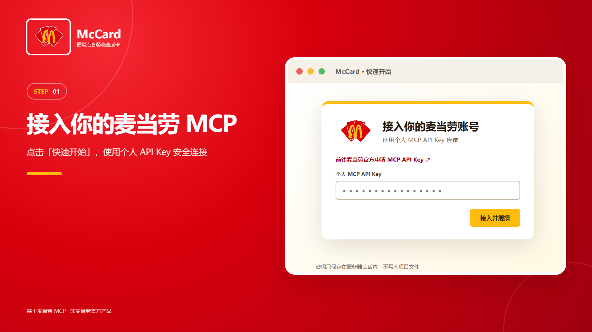
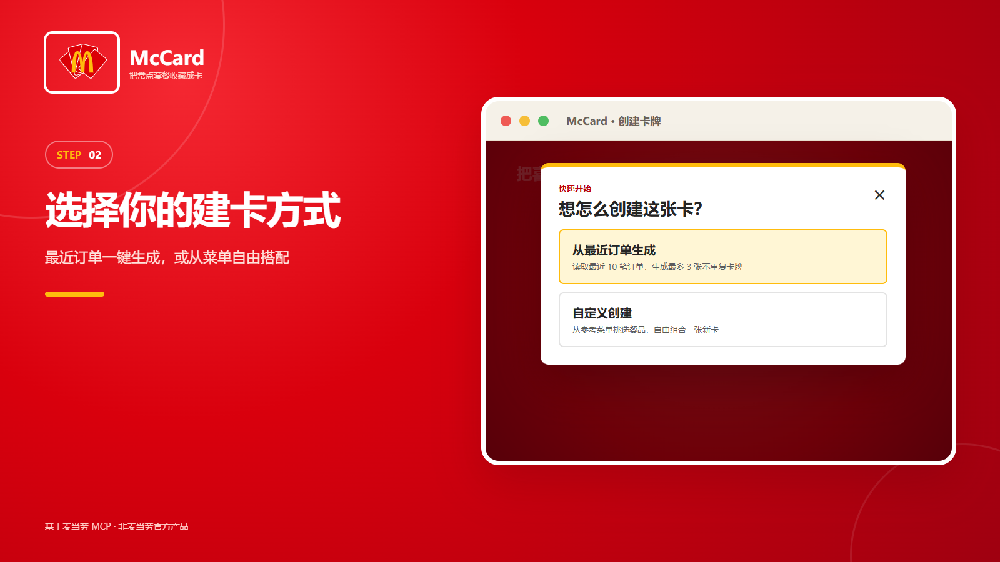
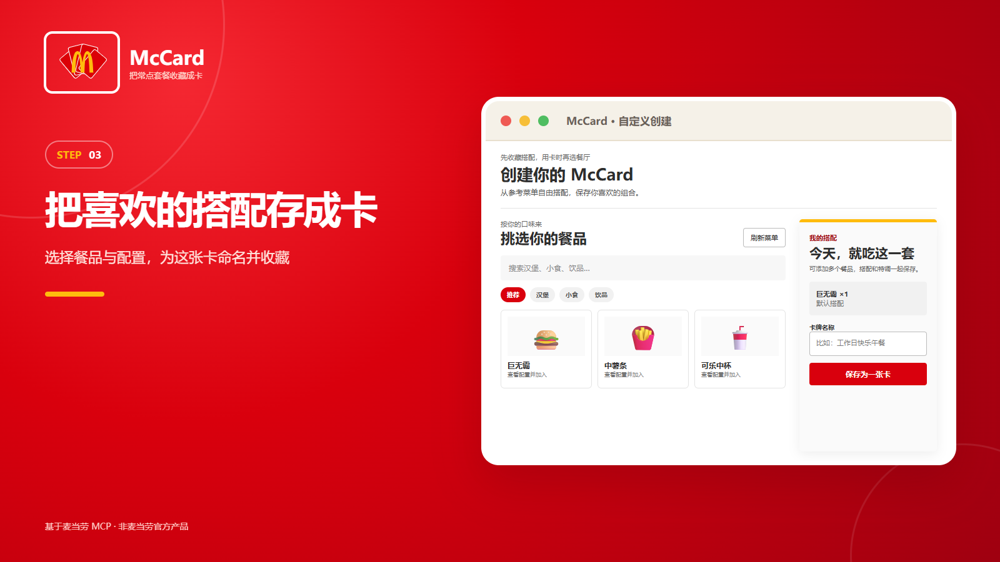
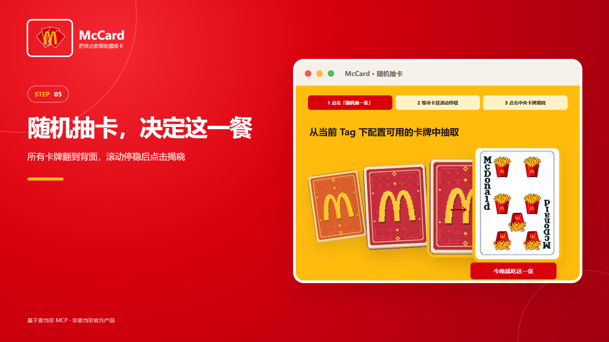

# McCard

把喜欢的麦当劳餐品组合收藏成扑克牌，在真实餐厅菜单中检查可用性、随机抽卡，并在确认价格后继续下单。

## 项目介绍

McCard 基于麦当劳 MCP，把容易遗忘的固定搭配变成最多 **16 张**可复用卡牌。用户可以从最近 10 笔订单生成卡牌，也可以浏览参考菜单，自由配置套餐、特调、数量和标签。使用卡牌时，McCard 会按当前门店重新检查菜单并核价；随机抽卡只从已确认可用的卡牌中选择。

核心能力：

- 最近订单去重生成最多 3 张卡牌，不保存订单号、地址或付款信息。
- 自定义餐品、套餐轮次和特调，使用 SQLite 保存在本机。
- 按餐厅检查卡牌配置，调用 MCP 实时核价并在用户确认后创建待支付订单。
- 按 Tag 筛选并随机抽卡，提供完整翻面、滚动和揭晓动画。
- 每位网页用户必须接入自己的 MCP API Key；密钥只保存在服务器内存会话中。

## 目标用户

- 经常复点固定套餐，希望省去重复配置的人。
- 在多个常点方案之间犹豫，希望随机决定这一餐的人。
- 希望研究麦当劳 MCP 菜单、订单、核价与下单流程的开发者。

## 快速开始

需要 Python 3.10 或更高版本，网页运行只使用 Python 标准库。

```powershell
python web_server.py
```

打开 http://127.0.0.1:8765/ ，点击“快速开始”，前往 https://open.mcd.cn/mcp 申请并填写个人 MCP API Key。随后可选择“从最近订单生成”或“自定义创建”。










## 功能与使用

保存最多 **16 个**常用点单方案，支持自定义标签、套餐搭配和特调。
每张卡在创建时按固定顺序绑定一个独立卡面：1～10、麦当劳叔叔、大鸟姐姐、汉堡神偷、奶昔大哥、麦当劳石膏头、麦当劳头。删除后新卡复用当前空出的最前卡面；旧数据库会按创建顺序自动补齐卡面。
方案不绑定门店或取餐方式，每次使用时先选择当前门店，再检查方案是否适用。

面向希望记录固定餐品组合的用户。使用 Python 3.10+ 标准库，无第三方依赖。

### 卡阵首页

运行 `python web_server.py` 后打开 http://127.0.0.1:8765/ 。`/orbit` 保留为同一首页的别名；“快速开始”跳转 `/builder` 建卡页面。
红白像素流动背景下展示 16 张双面卡牌，动画只用于展示。背景使用低分辨率 WebGL Shader 实时计算，白色纹理主要分布在外围，文字区域保留深红底；不支持 WebGL 时回退到静态渐变。固定半径 200，固定 15°/s 逆时针自动旋转，上下拖动仅调整俯视角（0–75°），左右拖动不改变旋转。没有暂停、反向、复位、参考线或键盘控制。系统启用减少动态效果时卡阵与背景自动静止。
卡阵下方为黄色连线串联的“搭配餐品 / 收藏成卡 / 选店用卡”三步说明，首页不提供门店或取餐方式表单。
美术资源统一存放在 `assets/`。卡牌正面位于 `assets/cards/front/`，补充卡面位于 `assets/cards/imported/`，统一使用 `assets/cards/back/card-back.png` 背面；品牌标志位于 `assets/brand/`。素材来源见 `assets/cards/imported/SOURCES.md`。
如需原先的 8768 端口，运行 `python web_server.py --port 8768`。

### 建卡页面

```powershell
python web_server.py
```

打开 http://127.0.0.1:8765/builder ，直接浏览参考菜单、配置餐品、填写名称/标签并保存，无需先选餐厅。
参考目录通过 MCP 查询固定参考门店 1420219 的到店菜单（`card_workflow.CATALOG_CONTEXT`），不代表全国全量餐品，也不代表实际用卡餐厅的供应。界面展示未优惠参考价；未返回原价时不使用优惠价替代。
支持分类和名称搜索、官方图片、套餐轮次与特调数量、草稿数量修改/移除，以及原卡编辑。保存只校验方案结构，不判定某家门店的供货或优惠资格。

“最近订单生成三张卡”调用只读 `order-list`（当前接口返回最近 10 笔订单，没有名为 `ordertop10` 的 MCP 工具）。按时间倒序提取最多 3 种不重复的已完成搭配，同时与现有卡包去重，并在同一数据库事务内限制最多 16 张。数量或特调不同不视为同一种搭配。不足三种时只生成实际数量，不填充虚构方案。
历史订单只返回餐品及扁平套餐子项，未提供完整特调、轮次；保留在 `historyChoices` 并标记 `needsConfiguration`，不自动补成默认口味。不保存订单号、门店、地址或付款信息。可在卡包中点“编辑 / 确认配置”，按参考菜单逐项确认；已下架的餐品需移除或替换。

打开 http://127.0.0.1:8765/library ，选择实际餐厅及取餐方式，检查每张卡的“配置可用 / 当前餐厅不可用 / 仍需确认”。换店只更新检查结果，不清空或改写卡牌。点击“核价并继续”会调用 `calculate-price` 展示当前整单金额及取餐方式；用户明确确认后才调用 `create-order`，并跳转 MCP 返回的麦当劳支付链接。创建订单前会再次核价，金额变化时停止下单并要求重新确认。
“我的卡包”入口要求先选择餐厅：当前标签页尚未选择时会弹出餐厅窗口，确认后进入卡包并自动检查；选择结果仅保存在当前浏览器标签页的会话存储中。直接访问 `/library` 也会执行相同拦截。
门店和取餐方式不入库，图片和价格不固化到方案。支付在麦当劳返回的支付页面完成；本地网页不收集或保存支付信息。卡包支持滚轮或方向键切换卡牌，也支持按当前 Tag 从“配置可用”的卡牌中随机抽取；动画停稳后点击中央卡牌揭晓。

这是本机单用户版本，仅监听 127.0.0.1，不能直接通过手机 IP 访问。MCP Token 只在后端使用；静态资源使用明确白名单，不提供 .env 或数据库下载。
可用 `--port 8766` 或 `--db data/another.sqlite3` 指定端口或数据库。网页和命令行默认共用方案库。
网页使用原生 HTML/CSS/JavaScript，后端仍只依赖 Python 标准库。

手动运行真实接口验收（仅临时数据库写入）：`python tests/live_web_smoke.py`。

### 命令行建卡

在项目 `.env` 中设置 `MCD_TOKEN=你的Token`，Token 可从官方平台
https://open.mcd.cn/mcp 获取。`.env` 和 `data/` 已被 Git 忽略。

在项目目录启动交互程序：

```powershell
python app.py
```

1. 选择取餐方式，输入城市和门店关键词，再选择具体门店。
2. 程序查询当前菜单及方案涉及的商品详情，再展示方案库。
3. 方案分为“当前可选”“需要调整”“暂未确认”，后两类显示原因。
4. 选择可用方案，或从当前真实菜单保存新方案。

## 新用户快速建卡

空卡库会展示新手入口，选择 `8 快速建卡`：

- 从当前门店实时菜单按批展示最多 4 份通过检查的默认套餐，每批最多探查 12 个商品。
- 名称只用于优先检索，是否为套餐以真实详情的选配轮次为准。
- 跳过会员随单购、查询失败、不兼容的搭配，以及已经保存的相同默认组合。
- 展示套餐组成，用户确认后才保存；可使用默认卡名，标签可留空。
- 每张候选为 1 份、默认搭配和默认特调；需要修改可返回 `2 自由组合`。
- 建议先保存 3 张，不强制数量。只有 1 张时可直接选用；有至少 2 张当前可用卡时开放抽卡。
- 保存第 2 张后可以立即试抽，也可继续添加；可随时返回，已保存的卡会保留。
- 没有候选时允许换批、自由组合或换门店，不填充虚构套餐。

网页快速开始已接入历史订单建卡；命令行快速建卡仍使用当前门店菜单生成候选。

## 抽卡

一个方案就是一张卡，卡包上限为 16 张。在主菜单选择：

- `6 全量抽卡`：所有当前可选的卡参与，不限制标签。
- `7 按标签抽卡`：选择一个已有标签，仅该标签下当前可选的卡参与；
  标签按完整文本精确匹配，未设置标签的卡也可单独筛选。

每次等概率抽一张，可连续抽取，也可能重复抽中同一张；不会删除卡、
消耗次数或按日期锁定结果。需要调整、暂未确认的卡不进入卡池。
主菜单要求至少 2 张当前可用卡才开放抽卡；按标签筛选后只有一张时会抽中该卡。
空卡池会提示原因。抽中后再检查一次可用性，
检查失败则提示刷新重试，不自动换另一张。该检查仍不保证库存。

保存时可以添加多个餐品、设置份数，保留默认搭配或调整套餐和特调，
最后输入方案名称及自定义标签。需要调整的搭配不会入库。
暂未确认的商品可以由用户确认保存，但不会成为“当前可选”方案。

切换门店或取餐方式后重新检查，不修改原方案。支持删除方案、重新检查。
同一轮检查内对商品详情去重查询，跨轮次不复用旧的检查结果。

原有文本工具仍可用于离线记录、查看和删除：

```powershell
python presets.py save --name "工作日午餐" --tag "常吃" --item "巨无霸" 1 --item "中薯条" 1 --item "可乐" 1
python presets.py save --name "两人加餐" --tag "双人" --item "麦乐鸡" 2
python presets.py list
python presets.py delete 1
```

`--item` 可重复使用，数量必须是正整数。名称和餐品名称不能为空。标签为自由文本，不传 `--tag` 时保存为空。允许同名方案，使用唯一编号区分；第 17 个方案会被拒绝，不会覆盖已有方案。

数据使用 **SQLite**，默认保存在项目下的 `data/presets.sqlite3`，关闭程序后仍然保留。
`presets` 表包含 `id`、`name`、`tag`、`created_at`，以及保存餐品、套餐和特调 JSON 的
`items` 文本列。上限检查与插入位于同一个写事务，不需要独立数据库服务。
可使用全局参数指定其他路径：

```powershell
python app.py --db data/another.sqlite3
```

上限按本地数据库计算。数据库保存个人餐品偏好，请勿提交到公开仓库。

## 当前边界

- 支持 **到店自取、得来速**。尚未实现外送地址选择及外送菜单流程，
  也未把“堂食”虚构为独立的 MCP 业务类型。
- “当前可选”只表示商品、套餐和特调匹配当前接口返回，不保证实时库存。
- 菜单未提供某商品时显示“当前菜单未提供”，不推断为缺货。
- 网络错误、旧文本方案缺少编码、会员随单购条件无法判断等情况显示“暂未确认”。
- 不领取优惠券，不将菜单展示价当成最终报价；核价与创建订单均使用当前门店的实时 MCP 结果。
- 不适用或需要确认的方案可进入建卡页编辑，保存后重新检查。
- 方案保存商品编码、名称、数量、套餐轮次和特调选择；门店及取餐方式不入库。
- 旧文本方案继续保留，因缺少商品编码会显示“暂未确认”，可从真实菜单重新保存。

另提供 `mcp_probe.py` 连接麦当劳 MCP 查询工具定义、门店、菜单和餐品详情。
接入方式与已验证的字段见 [MCP_INTEGRATION.md](MCP_INTEGRATION.md)。

非麦当劳官方产品，仅供参考。

## 验证

```powershell
python -m unittest discover -s tests -v
```

测试覆盖 16 个上限、持久化、门店切换、套餐轮次、特调 key、
查询失败、旧文本数据，以及 MCP 响应解析。
合成餐品仅用于单元测试，不是实时菜单或报价。

2026-10-20 已使用惠州华贸餐厅真实接口验证“菜单生成候选 → 确认保存两张卡 →
首次抽卡”。验收使用临时 SQLite 数据库，未向用户卡库写入测试卡。


### 个人 MCP 接入

网页不再使用服务器环境变量或 `.env` 中的默认账号。点击“MCP 接入 / 更换”，前往 https://open.mcd.cn/mcp 申请并填写自己的 MCP API Key。最近订单、门店、菜单、核价与下单均使用当前浏览器会话的账号；未接入时拒绝查询。用户密钥仅保存于服务器内存，8小时后过期，退出接入或服务器重启后失效；浏览器只持有 HttpOnly 会话标识。已移除项目 `.env` 中原有个人密钥。

当前方案库仍为本机共享数据库，尚未实现按用户隔离卡牌；MCP 接入会话不等同于多用户账户系统。
